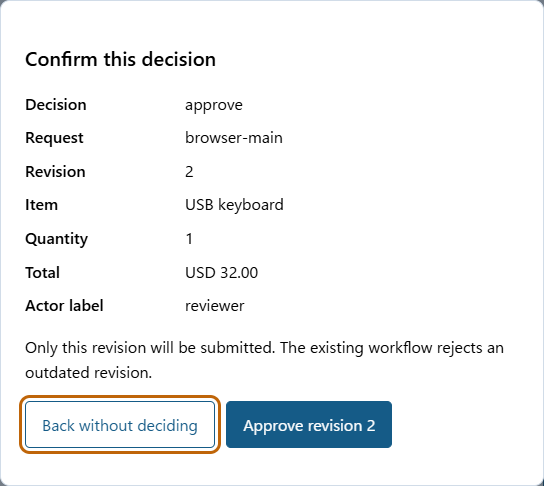

# Purchase Approval Service

[](https://github.com/skyon0522-ai/purchase-approval-service/actions/workflows/test.yml)

A runnable local purchase-approval workflow that rejects outdated approvals and prevents duplicate orders in a SQLite mock supplier when activities retry.

An operations team can inspect the complete path from request to decision to supplier order. Temporal retains the pending workflow when a worker process stops. SQLite detects repeated or conflicting supplier calls. The repository demonstrates these behaviors using actual Temporal execution and saved replay histories.

[Start on Linux](#try-the-browser-console-on-linux) · [CLI](#operate-a-request-with-the-cli) · [Verification](#verification) · [Scope](#scope)

## Try the browser console on Linux

Create and revise a request, inspect its exact revision and total, then confirm
approval, rejection or cancellation in a separate dialog. This interface calls
the existing Temporal workflow and SQLite mock supplier; it does not simulate
approval in the browser.



[View the full workspace](docs/assets/workspace.png).

Use Linux with Python 3.12; the recorded run used Ubuntu 24.04 x86_64 and
Python 3.12.3. From a clone of this repository:

```sh
python3 -m venv .venv
.venv/bin/python -m pip install --only-binary=:all: -r requirements.lock
.venv/bin/python console.py
```

Open the printed `http://127.0.0.1:8088` address. One foreground process owns the
local Temporal development server, product worker and console. The first run
downloads the pinned official Temporal CLI 1.9.1; package and binary acquisition
need internet access. It needs no Docker, cloud account, LLM API or paid service.

1. **Create request** using the fictional keyboard example. Keep its request ID.
2. Set quantity to **1**, then **Save a new revision**. The loaded revision is 2
   and its total is USD 32.00. Editing fields alone does not change the request.
3. Select **Review decision**. Inspect the request ID, revision, amount and actor
   label before confirming. **Back without deciding** and Escape make no decision.
4. Select **Reload current request** to confirm `released` and one mock order.
   An accepted approval can still be running; it is not yet proof of release.

Ctrl+C stops the console and its owned services. The two databases remain in
`.cache/console`. Restart with the same directory and **Load request** using the
same ID. A pending revision survived a full console/worker/development-server
restart in the local test. The console refuses a second process using its data
directory. This is graceful restart evidence, not a power-loss or backup test.

Use `console.py --port 8090 --data-dir /path/to/demo-data` for another local port
and data directory. Open the printed numeric loopback address. Unsaved browser
fields are not persisted across page reloads. After a lost response, the page
keeps the draft, disables further changes and directs you to reload the request;
it does not automatically repeat a write. A stale decision requires a reload too.
The Linux console is separate from the existing Windows-capable CLI below.


## Quick demonstration

**Observed result:** The demonstration submits two keyboards at USD 32.00 each, revises the quantity to one, rejects the revision-1 approval and releases revision 2. [Observed demo output](evidence/demo.json) includes these application results:

```json
{"step":"stale_decision","expected_revision":1,"current_revision":2,"result":"rejected"}
{"step":"supplier_orders","count":1}
```

The excerpt above omits the supplier payload for readability; the evidence file contains the complete emitted output.

Use Python 3.10 or newer. From the repository directory:

```sh
python3 -m venv .venv
.venv/bin/python -m pip install -r requirements.lock
.venv/bin/python demo.py
```

<details>
<summary>Existing Windows CLI setup</summary>

```powershell
./setup.ps1
.venv/Scripts/python.exe demo.py
```

The Windows setup uses an extended-length path because the SDK wheel contains deeply nested files. `./setup.ps1 -Python C:/path/to/python.exe` selects a particular Python installation. The new browser console requires Linux; it was not tested on Windows.

</details>

The first run downloads official Temporal CLI 1.9.1 into `.cache/server`. Python package versions and the CLI version are pinned. The first installation needs internet access for packages and that binary. It does not need Docker, an LLM API, cloud credentials or a paid service. Subsequent runs can use the cached binary. The demonstration starts and stops a local server automatically and deletes its temporary mock-supplier database.

## Operate a request with the CLI

Run the following in separate terminals after activating the virtual environment (`.venv/Scripts/Activate.ps1` on PowerShell, or `source .venv/bin/activate` on Linux/macOS):

```sh
python app.py server
python app.py worker
```

Use the same virtual environment in each terminal. The server binds to loopback, and the worker writes its mock supplier database in `.cache`. The server command configures its local database at `.cache/temporal.sqlite3`; its recovery is outside the console test, which uses the separate `.cache/console` directory.

In another terminal:

```sh
python app.py submit examples/request.json
python app.py status purchase-demo-001
python app.py revise purchase-demo-001 examples/revision.json
python app.py approve purchase-demo-001 --revision 1 --actor reviewer
# The stale approval fails. The current revision is 2.
python app.py approve purchase-demo-001 --revision 2 --actor reviewer
python app.py status purchase-demo-001
python app.py orders
```

Approval returns the accepted `approved` state. Check `status` for the completed `released` state and order ID. Use a new request ID for each new request; an existing ID is not silently overwritten. `reject` and `cancel` use the same revision and actor arguments as `approve`. Application `cancel` completes with a cancelled decision; it is distinct from Temporal's workflow cancellation. Ctrl+C stops a local server or worker. The CLI's global `--port PORT` can select another loopback port.

## Rules and limits

| Field or action | Rule |
| --- | --- |
| Request ID | 1..64 ASCII letters, digits, underscores or hyphens; first character alphanumeric; equals the workflow ID |
| Item | 1..200 characters; no surrounding whitespace or control characters |
| Quantity | Integer 1..1,000; booleans and decimal values are rejected |
| Unit price | Integer USD cents, 1..1,000,000 |
| Total | At most 10,000,000 cents; exact integer multiplication |
| Revision | Starts at 1; editing requires the current revision; at most 100 revisions |
| Actor label | 1..80 characters; a label supplied by the caller, not an authenticated identity |
| Editing and decisions | Allowed only while pending; unknown/missing fields and stale decisions are rejected |
| Supplier idempotency | Same request ID and identical payload returns the same order; a changed payload under that ID fails |

The workflow uses deterministic in-memory state changes and Temporal messages. SQLite access occurs only in an Activity or local client command. The supplier transaction and unique request key address duplicate calls after a commit whose acknowledgement is lost; they do not establish exactly-once behavior for a real external supplier.

## Verification

```sh
python -m unittest discover -s tests -t . -v
```

The suite uses a real local development server. It terminates and restarts distinct worker processes, rejects malformed and stale messages, validates an approved revision, exercises reject/application cancel/Temporal cancellation while pending, and retries a real supplier Activity after it has committed. It verifies conflicting idempotency-key reuse and replays four actual histories. Strict amount, text/ID and supplier-transaction boundaries have separate tests.

GitHub Actions runs this suite and demo on Python 3.12. The linked verification run passed; [view the run](https://github.com/skyon0522-ai/purchase-approval-service/actions/runs/37874765324).

The new Linux console adds five tests: four HTTP boundary checks and one actual
workflow integration test. The latter creates and revises requests, rejects
stale/duplicate operations, gracefully restarts the complete console with a
pending request, and checks approval, rejection, cancellation and owned-service
shutdown. Separate real-browser checks cover a stale second page, confirmation,
discarded acknowledgement, retained draft, one-order readback and escaped text
at desktop/mobile widths. See [the local record](evidence/linux-console-20261015.json)
and [console integration checks](evidence/console-integration.json).

The local record is separate from remote CI. The workflow now selects Ubuntu
24.04 and Python 3.12.3; consult the [workflow runs](https://github.com/skyon0522-ai/purchase-approval-service/actions/workflows/test.yml)
for the result at a particular published commit. The historical CI link above
concerns the earlier five-test application.


[Integration receipt](evidence/integration.json), [test summary](evidence/test-summary.txt), [verification receipt](evidence/verification.json) and four synthetic history files record what ran. Deliberate activity failures in the local logs are part of the acknowledgement-loss and conflict checks. Verbose process logs, virtual environments and downloaded binaries are excluded from source publication.

## Scope

This is one local purchase request type, one workflow and one SQLite mock supplier. It has no authenticated actors, authorization roles, real supplier API, payment flow, distributed database or cloud deployment. Cancellation is proven only while pending; cancelling after release cannot undo an order. The restart test covers the worker while the Temporal server remains running. Saved histories establish compatibility with the current workflow code; future code changes need their own replay check.

The application has not been validated with customers or production workloads. Read [source provenance](PROVENANCE.md) for the upstream patterns and application changes, and [implementation scope](IMPLEMENTATION_BRIEF.md) for the original acceptance boundary.

Read the [local security boundary](SECURITY.md) and [research-to-test mapping](RESEARCH.md) before extending the console.
